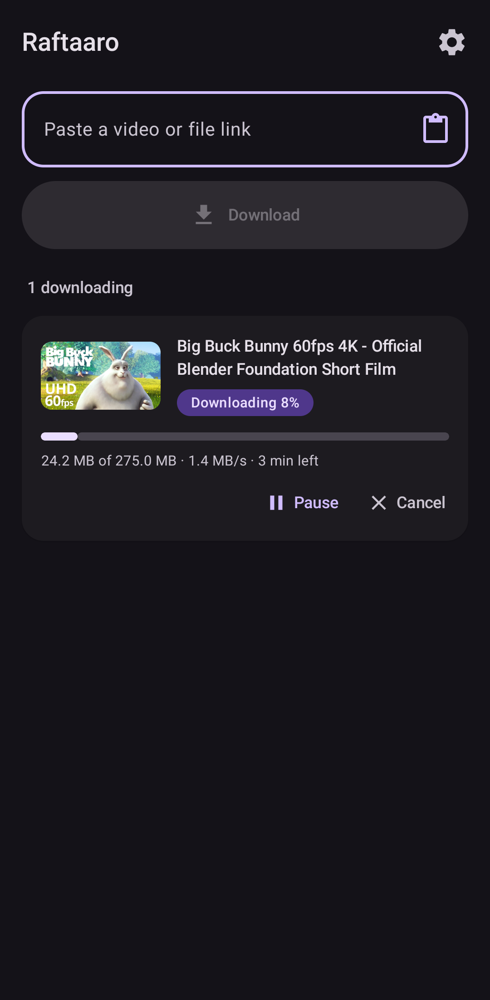
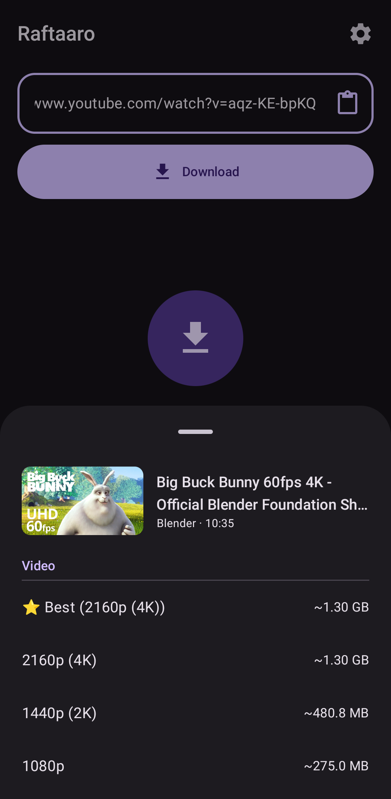
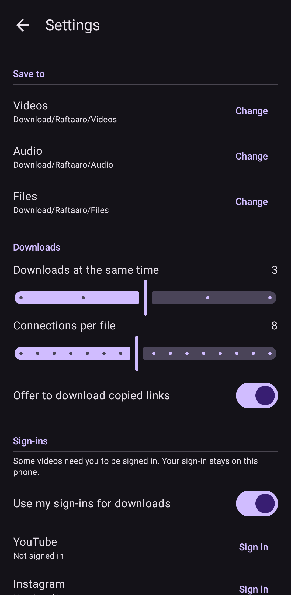

<div align="center">


# Raftaaro for Android ⬇️

**Download videos, audio and files on your phone. Share a link, pick a quality, done.**

[](https://github.com/Hamza-Bhai/Raftaaro-Android/actions/workflows/ci.yml)
[](https://github.com/Hamza-Bhai/Raftaaro-Android/releases/latest)
[](LICENSE)


[**Download the APK**](https://github.com/Hamza-Bhai/Raftaaro-Android/releases/latest) ·
[Video guide](#-video-guide) ·
[Report a bug](https://github.com/Hamza-Bhai/Raftaaro-Android/issues/new) ·
[Hire the author](#built-by-hamza)

</div>

<p align="center">
  
  &nbsp;
  
  &nbsp;
  
</p>

Raftaaro is a free, open-source download manager for Android with **no ads, no tracking and no account**. See a video in YouTube, Instagram, Facebook or any other app, tap **Share → Raftaaro**, pick a quality, and the file lands in your gallery. It is the Android version of [Raftaaro for Windows](https://github.com/Hamza-Bhai/Raftaaro-Downloader).

## How it works

```text
  YouTube / Instagram / any app  ──►  Share → Raftaaro  ──►  pick a quality  ──►  Download/Raftaaro (gallery)
```

1. In any app, tap **Share** on a video and choose **Raftaaro**. Or copy the link and paste it into Raftaaro.
2. Raftaaro shows the video's real qualities (144p up to 4K/8K), each with its size, plus audio as MP3 or M4A.
3. Tap one. The download runs in the background, with speed and time left in the notification.
4. When it is done, the video is in your gallery, in `Download/Raftaaro/Videos`.

## Features

- 🎬 **Videos and audio** from YouTube, Instagram, Facebook, TikTok, X, Vimeo and the [many other sites yt-dlp supports](https://github.com/yt-dlp/yt-dlp/blob/master/supportedsites.md).
- 📏 **Only real qualities**, each with its size, so you know what you get before you tap.
- 📂 **Playlists and channels.** Tick the videos you want; they go into a folder named after the playlist.
- ⚡ **Fast.** Several connections per file, and long videos are ready seconds after the last byte arrives.
- 🔁 **Steady.** A dropped connection carries on where it stopped, and paused downloads resume even after the phone restarts.
- 📄 **Any file link** (zip, apk, pdf…) with up to 16 connections at once.
- 🚦 **Queue** with a limit on downloads at the same time. YouTube downloads go one by one and wait when YouTube asks.
- 🔑 **Sign in** to YouTube, Instagram or Facebook inside the app for videos that need it. Your sign-in stays on your phone.
- 📋 **Copied links**: Raftaaro offers to download a link you just copied.
- 🔄 **Stays working**: yt-dlp, the engine that reads the sites, updates itself once a day.

## Install

1. Open the [**latest release**](https://github.com/Hamza-Bhai/Raftaaro-Android/releases/latest) on your phone and download one APK:

   | APK | For |
   |---|---|
   | `…-arm64-v8a.apk` | Almost every phone from the last years. **Pick this if unsure.** |
   | `…-armeabi-v7a.apk` | Older or low-cost phones (if the one above says "app not installed") |
   | `…-universal.apk` | Works everywhere, but is about 4× bigger |
   | `…-x86_64.apk` | Emulators and a few tablets |

2. Open the downloaded file. Android asks you to allow **Install unknown apps** for your browser or file manager; allow it for this install.
3. If **Play Protect** warns about an unknown app, tap **More details → Install anyway**. Raftaaro is not on Google Play because Play does not allow YouTube downloaders.
4. Updates: download the newer APK the same way. It installs over the old one and keeps your downloads and settings. `SHA256SUMS.txt` in each release lets you check the files.

Needs **Android 8.0 or newer**. Raftaaro is also being prepared for [F-Droid](https://f-droid.org).

## 🎬 Video guide

A short video showing how to install and use Raftaaro is coming soon.

<!--
  When the video is up, replace the line above with (put the YouTube video id in both places):
  [](https://www.youtube.com/watch?v=VIDEO_ID)
-->

## Where files go

| What | Folder |
|---|---|
| Videos | `Download/Raftaaro/Videos` |
| Audio | `Download/Raftaaro/Audio` |
| Other files | `Download/Raftaaro/Files` |
| Playlists | A folder named after the playlist inside the ones above |

You can pick other folders in **Settings → Save to**.

## Problems and fixes

| Problem | Fix |
|---|---|
| Downloads fail with **"yt-dlp is out of date"** | Open **Settings** and tap **Update now** next to yt-dlp. |
| A video **needs sign-in** (private, age-restricted, members) | **Settings → Sign-ins** and sign in to that site inside the app. |
| Downloads **stop when the screen is off** | Android's battery saver stopped Raftaaro. In *Settings → Apps → Raftaaro → Battery* choose **Unrestricted**. |
| YouTube says **"try again later"** | YouTube asked Raftaaro to slow down. It waits and continues by itself. |
| **"App not installed"** | Try the `universal` APK. If you had a test build, uninstall it first. |

## Privacy

Everything stays on your phone. There are no analytics, ads or accounts. Sign-in cookies are kept in the app's private storage and only used for that site's links.

## Responsible use

Download only content you have the right to download. Respect copyright and the terms of service of the sites you use.

---

## Build from source

Needs JDK 17 and the Android SDK (platform 35). Put the SDK path in `local.properties`:

```properties
sdk.dir=C\:/path/to/android/sdk
```

| Command | What it does |
|---|---|
| `./gradlew testDebugUnitTest` | Unit tests (JVM) |
| `./gradlew connectedDebugAndroidTest` | Device tests (a phone with USB/wireless debugging; some need internet) |
| `./gradlew assembleDebug` | Debug APKs in `app/build/outputs/apk/debug/` |
| `./gradlew assembleRelease` | Release APKs (R8-shrunk), one per ABI plus a universal one |
| `./gradlew assembleRelease -PytdlpAutoUpdate=false` | The F-Droid variant: yt-dlp updates only from Settings |

### Release signing

Create a key once and **keep a backup of it and its password**. Without it you cannot ship updates:

```bash
keytool -genkeypair -v -keystore keystore/raftaaro-release.jks -alias raftaaro -keyalg RSA -keysize 4096 -validity 10000
```

Then add to `local.properties` (git-ignored):

```properties
release.storeFile=keystore/raftaaro-release.jks
release.storePassword=...
release.keyAlias=raftaaro
release.keyPassword=...
```

Without these, a release build is left unsigned (F-Droid signs its builds with its own key). For a quick local test, install the debug build instead.

The GitHub release workflow ([`release.yml`](.github/workflows/release.yml)) runs on `v*` tags and attaches the signed APKs to the release. It needs these repository secrets (*Settings → Secrets and variables → Actions*):

| Secret | Value |
|---|---|
| `RELEASE_KEYSTORE_BASE64` | The `.jks` file in base64. On Windows: `[Convert]::ToBase64String([IO.File]::ReadAllBytes("keystore\raftaaro-release.jks")) \| Set-Clipboard` |
| `RELEASE_STORE_PASSWORD` | The keystore password |
| `RELEASE_KEY_ALIAS` | `raftaaro` |
| `RELEASE_KEY_PASSWORD` | The key password |

## Repository layout

| Folder | What it is |
|---|---|
| [`app/`](app) | The Android app (Kotlin, Jetpack Compose) |
| [`fastlane/`](fastlane/metadata/android/en-US) | Store listing: description, changelogs, screenshots |
| [`fdroid/`](fdroid) | Draft F-Droid build metadata |

## Credits

[yt-dlp](https://github.com/yt-dlp/yt-dlp) (Unlicense), [FFmpeg](https://ffmpeg.org/) (LGPL 2.1+), Python (PSF) and QuickJS (MIT), bundled by [youtubedl-android](https://github.com/yausername/youtubedl-android) (GPL-3.0). Screenshots show [Big Buck Bunny](https://peach.blender.org/) (© Blender Foundation, CC BY 3.0).

## License

[GPL-3.0](LICENSE), because the bundled youtubedl-android library is GPL-3.0. The [Windows app](https://github.com/Hamza-Bhai/Raftaaro-Downloader) is MIT.

---

## Built by Hamza

Raftaaro is an independent open-source project by **Hamza**. If you like it, a ⭐ on the repository helps a lot.

**Need something built?** I take on custom software work. If you have a product idea or a business problem, get in touch. Typical projects:

- 📱 **Android apps** (Kotlin, Jetpack Compose)
- 🌐 **Web apps and websites**
- 🧩 **Odoo** development, customization and integrations
- ⚙️ **Automation, backend services and command-line tools**
- 💻 **Desktop tools** for Windows, macOS and Linux

📧 **Email:** [hamzapervaiz276@gmail.com](mailto:hamzapervaiz276@gmail.com?subject=Project%20inquiry%20%28from%20Raftaaro%29)
